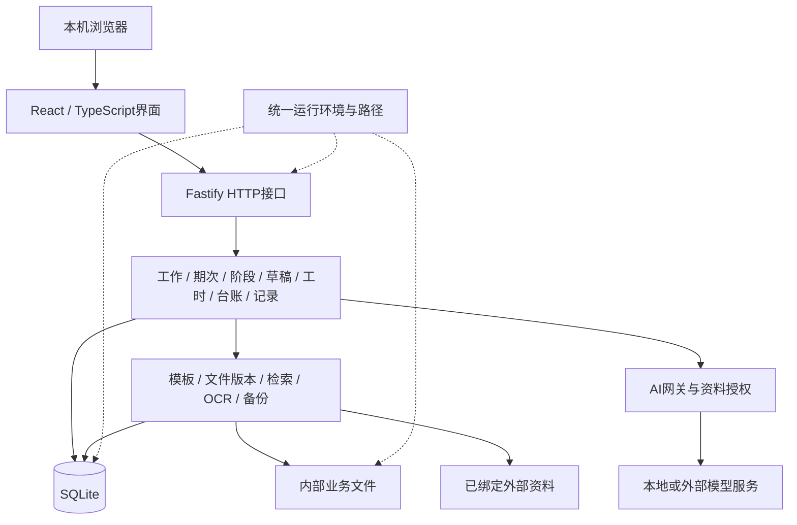

# 系统架构

文档ID：KB-ARCHITECTURE。版本：1.46。更新：2026-11-12。性质：当前源码的结构与运行设计。

本文回答系统由哪些部分组成、怎样协作和保存数据。实际运行版本、测试结果和交付进度由[开发进度](DEVELOPMENT_PROGRESS.md)维护；项目介绍见[README](README.md)，业务含义见[术语](CONTEXT.md)。

## 1. 整体结构

工作台是面向本机单用户的模块化单体应用。React前端通过HTTP调用同一Fastify后端，后端在一个应用中组织业务模块、文件处理、数据库和AI能力。npm workspaces管理前后端依赖。

技术栈为React、Vite、TypeScript、Node.js 24+、Fastify及Node内置SQLite。文档处理使用ExcelJS、PizZip、PDF.js、Tesseract.js；旧版Excel转换依赖Windows上的Microsoft Excel。具体依赖版本以package-lock.json为准。

### 页面导航与布局

React 通过 `App.tsx` 解析 hash 路由及工作、期次、文件、模板等对象标识。13 张图覆盖主页面及其内嵌详情、编辑状态和创建弹窗。桌面壳层以 `desktop.css` 统一侧栏、页头、表格和操作按钮。PageActions 用 React portal 将文件、模板、工作列表及回收操作放到页头，按钮继续使用所属页面的编辑状态和请求。首页、工作列表、工作详情及流程配置共用 SearchControl，文件和模板命中复用原预览弹窗。`work-management.css` 负责工作列表、新建、配置和回收站，`work-detail.css` 负责工作详情及工时，`pages/library-pages.css` 负责流程、资料和会话。内容区承担页面纵向滚动，低高度弹窗可整窗滚动。知识库按已存模板 category 的路径段生成分类，列表选中项提供元数据及操作，字段映射沿用独立模块。制度维护继续复用 Settings 内的 PolicyMaintenancePanel，引用跳转可展开，折叠保留已挂载状态。

Dashboard 复用 useWorkflowInbox、工作集合与成果接口。待办保留登记与截止日期，“继续办理”按更新时间排序。桌面首页按内容区高度分配两列卡片，使用匹配媒体查询的分页容量，窗口缩放时按条目偏移定位。窄小视口恢复页面滚动。辅助列直接呈现统计、近期截止及完整月历弹窗、最近三项成果与 RecordComposer。随手记沿用工作记录接口、请求键与编辑保护。工作期次、周期提醒及计划结束日期用于截止展示，首页挂载沿用已有期次同步。

Workbench 列表将筛选、关键词、页码和滚动位置记入当前列表历史位置。服务端同时返回待办期次标识及截止日期，“继续办理”携带同一条期次的 periodId；期次选择以链接为准，显式无效的期次提示重选。桌面按页面滚动，分页跟随表格末行，窄屏将主要操作放在名称旁。首页搜索在原结果上按对象 ID 打开文件或模板预览；带对象编号的文件库和模板库链接也能打开对应内容。

App 的窄屏导航支持原地关闭与焦点返回。可折叠 Card 的标题以按钮暴露展开状态，右侧操作保持独立。工作记录沿用现有读取接口，通过详情弹窗查看来源与历史。工作页隐藏自指的草稿编辑链接。设置页按栏目保存滚动位置，低频维护区折叠。编辑弹窗通过 NavigationGuard 复用保存、确认放弃和失败后的原输入；密钥明文可见性只由本次输入框的显示开关控制。

Process 按工作类型加载 ConfigState，将阶段字段保存在同一份配置草稿中，展开状态只控制当前编辑区。保存沿用草稿修订检查，顶部操作栏随滚动可用。工时逐日编辑在 MonthlyTimesheet 的侧边弹窗处理指定人员、日期与依据，保存仍分别经过原有逐日覆盖或份额分配接口，成功后载入新计算版本。

Workbench行政创建将编号、额外模板和说明放入可选折叠区，仍提交发布版本并沿用既有创建接口及配置快照。工作详情将业务办理与材料核对、工作级关联记录分区呈现，期次完成和阶段状态操作复用原接口及校验。配置应用保留在折叠区；Periods对timesheet执行器内嵌现有MonthlyTimesheet，传入工作/期次/月份和快照模板，通用文书默认收起。无周期的旧工时工作同样显示办理组件，周期读取失败不回退到错误范围。工时输入、结果和版本区随页面滚动；三主来源并列上传，窄屏自动换行。MonthlyTimesheet按实际输入状态显示下一步，来源入口默认展开；绑定模板通过既有library/inspect接口由用户显式选择，查看页面不自动导入模板。研发、部门表及考勤仍使用现有解析器；独立项目月报XLSX使用project-report.ts按字段发现，任意项目清单仍不保证适配，项目名可手填。流程配置中的周期步骤仍为指导文字，未引入通用步骤执行器。MonthlyTimesheet外层通过既有period详情核对工作与report_period，绑定月份只读，表单按范围重建；本机草稿及历史记录载入核对工作/期次/月。pendingAttendance只保存在前端输入草稿中，与已采用主/补充来源分开；验证键绑定来源ID、月份与映射，编辑或草稿恢复使验证失效，待采用时禁算。上传、验证期间锁定输入并复用NavigationGuard/useAction；采用后添加补充或显式替换主来源，取消不删除副本。components/timesheet-input.ts集中范围匹配及采用检查。既有POST /api/timesheets/inspect仅为attendance接受可选mapping，用原schema及readMapped校验；自动识别与人工映射均核对来源月份和日期；计算服务接收已采用来源，按当月名单与项目执行整数分配。

项目月报沿用timesheet_source上传副本与digest校验，inspect增加project-report种类；解析器跳过空页，寻找唯一项目名称/项目建设单位/本月完成情况表头，不依赖Sheet1、固定行列。重复表头/公式字段/缺失名称/异月标题拒绝，保留同名源行和100%项目；只从表头之前月报标题读显式年月，不读取下月计划推断月份。模板catalog按明确项目名称及客户名称/合同编号表头提取参考值，歧义给提示，原departmentLayout项目名仍可复用。ProjectReportReview与project-report-input管理候选、逐项确认、显式合并及可选简称；pendingProjectReport计入原草稿/离开保护，恢复清除验证和确认，重新读取源文件，待采用禁算。采用合并清单并保留人员参与、手工输入及旧来源；installTimesheetTemplate保护已有清单和参与关系，模板people只写入前端peopleCandidates，不写requiredPeople或assignments；历史偏好只进入referencePeople参考展示。既有名单文本框是明确确认范围入口，无名单禁算，独立切月把旧名单降为候选。projectReport与最多10份替换来源projectReportHistory进入原run输入JSON；计算时重新读取来源、核对digest/月/源行/显式确认，保存来源字段与映射快照及sourceFiles，定稿前重验副本。采用记录供溯源，之后人工清单/参与调整仍以当前输入为准，不由历史月报选择强制推算人员工时。createTimesheetRun及创建API要求显式非空名单，不再回退模板姓名；模板inspect返回完整来源候选，preferences默认不设excluded。既有preferences数据只读保留，不迁移个人范围。每次计算仅重建已知自动“名单外”排除标记，使之后明确纳入人员不受旧派生标记阻挡；其他人工排除依据保留，原历史不改。无新表、迁移或分配算法。

启动工作台.cmd 与 npm start 共用当前源码的一条启动链。开发服务和隔离测试各用专属环境。启动时的构建、实例切换和清理见第 8 节。

## 2. 模块与职责

| 位置 | 职责 |
|---|---|
| packages/web/src/pages | 首页、工作、流程规范、文件、知识、助手、设置、回收站及工作记录页面；工作内承载期次、阶段、工时和台账 |
| packages/web/src/components | 草稿、预览、附件及共享界面；NavigationGuard从注册编辑器读取最新状态和回调，统一处理离开确认与刷新保护；useWorkbenchCollection按归档/工作类型完整分页，WorkbenchSelect统一加载、失败重试与原选择保留 |
| packages/web/src/api.ts | HTTP调用、响应类型、错误与会话令牌处理 |
| packages/server/src/index.ts | 进程锁、初始化、请求保护、路由与静态资源注册 |
| packages/server/src/api | 参数与归属检查、错误响应、领域服务调用；常规响应使用ok/data或ok/error信封 |
| packages/server/src/domain | 工作、期次、阶段、检查草稿、成果、版本、工时、年度台账和工作记录等业务规则 |
| packages/server/src/core | 配置、路径、文件登记、模板、检索、OCR、日志、备份及运行保护 |
| packages/server/src/ai | 服务商与用途档案、模型调用网关、资料授权、调用日志和助手能力 |
| packages/server/src/db | SQLite连接、事务与有序迁移 |
| scripts | 允许共享的启动、开发、隔离测试运行器、打包、快照和仓库检查工具 |
| packages/server/test | shared 子目录保存合成回归与生成器；其余私有用例单独保存，均不参与运行副本构建 |

这是职责划分，不宣称已经实现完全独立的模块部署或严格无环依赖。生产需要的旧Excel转换工具位于core/convert-legacy-excel.ps1，通过模块相对路径调用，不依赖本机测试脚本。

## 3. 业务对象与数据关系

工作类型定义流程、阶段要求和模板适用关系。具体工作承接这些规则，并关联各自的期次、阶段和成果。

- 周期工作通过work_period区分月、季、年范围；阶段通过position_instance表达项目过程，二者不混用。
- inspection_draft保存可编辑字段、来源及修订历史；inspection_record登记实际检查。草稿不自动进入真实检查统计。
- artifact登记成果与工作、期次、检查等的关联及文件位置；doc_version保留修订和核对关系。
- template及position_template_doc表达模板内容和适用范围；目录分类不等于复制业务事实或模板。
- 工时计算保存来源与计算输入；年度台账维护记录、修订、关联文件与同步依据。
- work_record及其历史、回答记录维护用户原话与有效引用；与旧agent_memory分开。work_record.workbench_id是显式关联，WorkRecordLinks在工作详情展示有效记录摘要，WorkRecords以URL workbenchId调用已有记录查询；未关联记录保留在默认总列表，不以工时或检查的项目文本推断关系。筛选名称和有效性复用分页工作列表（含归档核对），不读取会重算的领域详情。

完整对象说明见[术语](CONTEXT.md)，字段与接口定位见[数据与API](docs/reference/DATA_AND_API.md)。实际数据库结构须核对schema_migration的完整集合，不能仅由源码文件或最高迁移编号推断。

### 3.1 流程配置版本与实例来源

041迁移增加workflow_config_draft和workflow_config_version；草稿用revision及base_version_id校验，work_type.published_config_id为唯一当前发布指针。版本含整套JSON、摘要、版本号、来源与变更说明，数据库触发器禁止修改/删除。workflow-config.ts与routes-workflow-config.ts承载新建/复制、保存、预览、发布、放弃草稿和可用性操作；Process与WorkTypeEditor复用NavigationGuard、同步锁和冲突比较界面。

发布在同一事务中验证草稿基线和预览摘要、追加版本、更新规范表兼容投影/发布指针、递增草稿修订及写入operation_id事件。相同操作签名重试不会重复发布；任一步故障整体回滚。work_type、position_template、material_check、evidence_rule、position_template_doc的旧写API返回409；数据库投影写守卫只在发布事务中放行。旧阶段/材料/影像使用稳定ID或config_key更新/停用，不删除历史引用；当前模板绑定投影可以替换，但实例已存的绑定不改。

启动和升级工具在完整seed后只为config_baseline_pending旧类型建立一次legacy-baseline；新建草稿设pending=0，重启/种子不会把草稿当成旧配置发布。异常period_defaults原样保留兼容字段，缺失/失效模板提示问题而不猜测修复。旧workbench、position_instance等来源仍NULL，不倒填新版本身份。

新工作在同步创建事务中核对expected发布指针与启用状态，保存source_config_version_id、rules_snapshot的版本/实际阶段与instanceChoices。新阶段、周期规则分别保存来源和实际规则，材料用途用config_key/requirement_kind，生成模板保留按材料key解析的materialBindings，单模板多要求不覆盖材料身份或必备性。生成字段接口列出明确目标，多要求保存及版本链查询须提交materialId；单要求保持隐式兼容。版本头从该材料实际artifact_id读取，提交时再核对关联与状态，防止另一成果或并发绑定串链。完成检查按保存的material_rules逐项要求有效、同模板的实际关联文件；模板级旧检查仅用于未结构化部分。旧无结构规则保留原单映射，名称回退仅限config_key为空；有损templates快照可从原material_rules只读解析，不重写快照或定稿。直接修改现有周期规则会清除该规则的精确版本来源；创建来源仍作为历史保留，不声称之后所有本地选择都等于原配置。旧规则无结构映射时保留原算法；新规则改材料名需提交对应结构，不能自动猜测映射。WorkDocuments逐项关联保留待提交选择与原expected快照，独立同步请求锁防止重复提交；linkBusy和未保存选择接入现有NavigationGuard，保存并离开等待成功，失败显示错误并保留选择，可明确重试或放弃。放弃仅清除本页未保存选择，不撤回在途请求、不删除已保存关系；空选项仍不支持清空既有关联。

新实例的空template_ids/doc_requirements是明确空绑定，不回退到实时类型；模板选取和阶段/期次绑定记录模板与变量配置文件摘要，生成范围校验以实例绑定为准，当前类型移除模板不取消原实例引用。模板实体被版本引用后不能彻底删除；文件缺失、停用或摘要变化会拒绝相关新建/生成并提示处理。这里保存引用及指纹，不是独立冻结一份模板二进制或历史模板渲染器；不能承诺外部文件在检查后绝不变化。来源未知的旧实例继续原有动态回退，兼容基线不意味着旧语义已全面冻结。

新工作拒绝隐藏的periodRule/instantiatePositions覆盖；选模板与起始期次以实际选择记录。失败时数据库回滚，仅删除该请求新建且仍为空的目录，不清理已有业务文件。在办实例不能通过旧instantiate接口追加当前类型阶段，统一走明确差异应用。停用只改变新建可用性，不更新已有实例、周期、进度或定稿；已使用类型禁止改变领域、业务分类、办理方式和执行器。已发布名称/展示分类等仍是类型元数据，不构成历史事实证明。

### 3.2 在办范围的部分配置应用

042为阶段增加config_snapshot/description，为清单增加config_key/rule_snapshot，并新增不可原位改写的work_period_future_rule。只增加结构，不回填旧来源或改旧快照。workflow-application.ts提供POST workbenches/:id/config-preview与config-apply；WorkflowApplication位于工作详情，展示允许项、禁止原因、前后配置、确认和部分应用历史。

预览读取工作、阶段/清单、成果、待办、记录、记忆、生成记录、期次/材料与规则；检查目录安全性及模板摘要，不调用recalc/sync或写业务表。仅比较同类型当前发布版本；无法证明原执行语义或安全范围时拒绝。阶段显示信息应用固定既有目录名，不移动文件。新增阶段保存独立配置与清单规则快照、稳定材料身份和来源，状态为pending；旧阶段材料/影像要求不覆盖。既有文书预览/确认接口复用同一安全守卫。工作或阶段有明确发布来源时，经publishedPositionDocumentTarget读取当前同类型不可变发布版本，保留发布指纹并与新入口共用模板有效性、内容和字段映射校验；不从当前文件重算后当作已批准的指纹。预览携带targetVersionId，确认事务重新比较预期对象，拒绝失效或变化的版本/模板。新旧提交都在数据库写入后、提交前再检查所选模板及发布指针，发现变化时要求、进度和事件共同回滚。真正未知来源保留原动态分支及安全范围守卫，不倒填来源；无原规则依据仍拒绝。对应页面保留预览、同步互斥并注册离开保护。

应用事务核对预览摘要、当前指针、所选项及组合后的顺序，拒绝过期或不安全范围；同operation_id和请求摘要重试返回已保存结果，异请求复用编号冲突。阶段/清单、必要进度和workflow_event共同提交或回滚；updateStoredProgress复用原完成门槛但不刷新既有影像计数/完成时间。事件记录原来源、目标版本、实际范围及前后配置；workbench原始版本与rules_snapshot不变，不把部分应用标成全量升级。

未来规则采用追加的明确生效记录，边界晚于今天、全部已有期次及已排定规则；相同规则不重复安排，频率不变。应用只存规则；原syncPeriods按报告日期选择相应版本，已有期次直接保留，新期次继续用原材料身份和共用模板独立映射。已有未来安排时旧规则编辑拒绝覆盖，应通过差异入口安排更晚规则；不支持原位撤销/编辑已排定规则。来源未知或实际清单已调整的旧阶段保持原状；这不是历史数据全面冻结或任意流程迁移器。

## 4. 存储与文件一致性

SQLite保存业务记录、状态、关系、设置、模型配置和处理日志。磁盘保存实际模板、附件、原始副本、成果及历史版本。模型凭证属于当前环境的私有配置数据，不能进入共享文档或源码样例。

文件通过登记记录、根目录类型和已绑定路径定位，不按同名文件猜测。外部参考原件保持只读；可写的绑定成果按显式业务操作处理。外部原件不自动包含在内部文件快照中。

数据库与磁盘是两套存储：数据库事务不能单独保证文件操作成功。document-write、来源签名、修订校验、版本保留及失败补偿共同保护写入；不宣称存在覆盖所有数据库与文件操作的整体事务。

软删除、恢复和文件访问共同检查父对象状态。父级恢复仍只恢复同批deleted_at对象，独立删除不混同。单附件和整工作彻底删除共用进程内文件补偿：按实际路径去重，先在runtime/purge-recovery为每个待删除文件备齐私有副本和原路径说明；以副本哈希核对当前文件，再在一个数据库事务中清记录、逐份unlink并提交。整工作预检中的只读/指纹不符/外部存活引用按既有安全阀保留磁盘文件，并通过skipped说明；无法确认路径则整次拒绝。外部引用按各自绝对路径比对，不仅比较file_rel；同路径多条登记任一不满足保护条件就保留整份文件。复制后重新核对引用和内容，数据库事务内比较父工作与附件登记快照，变化拒绝。文件或数据库失败回滚并逐份排他补偿；一份补偿失败继续其余恢复，全部副本保留并报明位置，不覆盖新文件。错误说明失败阶段、文件编号、补偿及未删除数量；提交成功但副本清理失败返回warnings。绑定目录只在提交后回收平台空目录，拒绝链接及只读目录，根目录/未登记文件保留。带文件操作拒绝外层事务；withFile=false仍仅处理数据库。该机制增加临时空间、复制及哈希开销，没有持久operation_id或重启扫描协议，不保证断电/进程崩溃、跨盘/跨进程原子性；清空回收站逐目标提交不是整批事务。

附件deleteArtifact的withFile=true软删也复用上述文件补偿；普通软删保留磁盘文件，安全拒绝则保留文件、继续软删并返回fileSkipped；补偿副本清理故障随该拒绝携带warnings，不改变安全跳过语义，随后记录事务若失败仍明确报错及残留副本位置。artifact_search/软删标记、OCR队列、初检、syncEvidence及关联kb_document/kb_chunk/全文索引在同一事务内处理，任一步或提交失败一起回滚；补偿冲突保留副本。已软删记录再次调用不碰新放回的文件。派生知识延续原删除行为，返回kbDocumentsRemoved及恢复后重导入提示；缓存在事务成功后同步失效，事务内矩阵读取不复用或填充全局缓存，避免普通软删外层回滚污染。提交后副本或附件根内空目录清理异常返回warnings，不误报整个删除失败。旧解绑入口保持仅软删记录；未增加页面选项、持久任务或自动重试。

派生知识的活动读取复用trash.visibleKbDocumentFilter：无附件文档保留原有可见性，有附件则要求附件及父工作均可见。KB列表、正文/片段、条款查找、全文/全局检索及统计沿用此条件，原stale和版本筛选另外保留。整工作删除/恢复不改知识原行或向量；向量缓存保留原片段，读时按当前事务可见状态筛选，恢复不等待TTL，事务内不填充全局缓存。语义/混合及统一检索在await后重新过滤，KB问答调用模型前后核对所用文档，变化返回409；助手本轮记录所用制度ID，在下一次模型调用前、返回后及保存回复前核对，失效则撤回本轮答案与检索trace的参数/结果，仅保留工具名和固定状态并提示重新查询，不自动重试。已发送给本地模型的上下文无法追溯收回，历史会话不被重写；这不是全局授权框架或跨进程快照协议。

清空先读取现有倒序列表最多2000条快照，再按严格早于保留期界线选目标，不无限取数。满足保留期且位于快照内的工作/字段先处理，其本批附件/阶段/别名在父成功时标covered、失败时标notExecuted，不拆组重试；父删除仍包含其所有子记录（含日期较新或快照外子项）。purged只计实际独立成功目标，retained计保留期未处理，protected计安全拒绝且记录保留，failed计真实失败，notExecuted计未执行；六类互斥总和等于快照条数。skipped是已提交目标中按规则保留的磁盘文件，不与目标数相加；warnings为提交后的清理问题。items携带种类/ID/名称、父目标及原因，scope标总数、快照数、上限、快照外数、结束剩余数与保留期；快照外数不保证这些记录未被父级联删除。补偿成功后的SafetyRefusal保留类型供清空分类，文件动作顺序不变。

Trash页面用同步ref互斥清空，执行中锁定范围、关闭与筛选，并向既有NavigationGuard注册在途状态。结果留在对话框或页面卡片，刷新列表不清结果；部分失败/安全保留/警告用非全成功反馈。未收到完整响应时结果未知，先主动重新核对全部类型列表，直接展示该响应的可读快照后再明确确认重试；核对快照不受页面类型筛选或后台列表刷新失败影响，重新核对先撤销旧许可，失败不解锁；不自动重发不确定请求。页面状态仅本次挂载有效，强制离页/刷新后的结果不持久化；没有服务器并发幂等键、任务队列或重启协议。

外部附件采用“文件上传→材料关联”的两步操作。PeriodAttachments在获得文件编号后暂存按工作/期次隔离的恢复信息；关联失败直接展示已保存文件与重试入口，避免断服时刷新父级导致编辑器卸载。重试先读取当前材料；同一文件已提供或已核对时只确认成功。关联PUT的可选expected快照在事务内比较原关联、状态、标题、必填属性及用途，拒绝读取后发生的冲突；重复请求不重复事件或降级verified。该机制不新增数据表，不保证POST结果未知时的上传幂等，恢复信息不跨刷新保存。

应用与导出设置的三个字段（app.org、app.operator、ai.writing_style）通过PUT /api/settings提交完整_expected原值快照。后端在同一SQLite事务中比较当前值后写入；缺快照返回428，格式不合要求返回400，值冲突返回409并附这三个字段的最新值，混合请求整体不写。其他设置仍支持原扁平请求。旧页面直接写这三个字段会被要求重新打开，不能静默覆盖。这里比较字段值，不提供历史修订编号或跨资源锁。

Settings保留编辑基线和冲突输入，用户比较最新值与本页输入后，明确保留自己的改动并更新未改字段，或放弃本页改动采用最新值；重新保存仍受事务校验。月度Periods统一维护补充说明内容、成功基线和保存锁，普通保存、模板生成前保存及NavigationGuard共用保存函数；成功后刷新期次详情及父级列表，失败不更新基线，保存期间禁止编辑和离开。Periods使用详情返回的files供附件展示及文书refreshKey，不再维护未消费的工作文件查询；WorkDocuments保留自身成果查询、失败重试和操作后刷新，文件ID/定稿标记变化通过refreshKey触发重载，内容变化后的有效性由最新readiness判断。

## 5. 关键业务链路

| 链路 | 处理方式与约束 |
|---|---|
| 检查草稿 | 当前期次及同工作历史 → 创建/恢复草稿 → 人工编辑或限定字段AI建议 → revision校验 → 采用/生成。人工修改优先，陈旧响应不能覆盖新稿；必要事实齐全且明确确认后才登记实际检查 |
| 正文与模板选择 | 非期次正文分别记录磁盘确认值、本次送出的正文和页面当前值，在同一标签页按工作恢复草稿；更新接口在事务内核对原文。模板选择的草稿随编辑器保存，收起后继续参与离开保护，期次模板沿用预览、比对、应用流程。 |
| 文书生成 | 收集有范围的业务上下文与来源 → 模板及建议 → 生成、登记成果与版本 → 下载；来源变化提示重新核对，生成不代表报送或完成 |
| 月度工时 | 当期名单、项目、来源与可编辑输入独立于运行快照。扣除当日研发后分配整小时，不能整分时报告冲突，人工调整另建版本。新版财务表按当期明细重建研发、部门和汇总行；计算与导出共用同一套填表和公式核对。插入行列前记录原公式与引用，按原位置迁移直接引用及受支持的 SUM 区域，核对依赖并写入新缓存。涉及不能安全解析的依赖时，返回工作表、位置和原因并阻止定稿。定稿文件登记、期次归属与运行状态在同一事务内提交。 |
| 在办与历史项目 | dossier.ts 收集阶段材料与工作级文书缺口，详情、阶段完成与归档使用同一核对依据。历史项目保留未知事件日期。 |
| 提醒与期次 | 简单提醒沿用工作排期；具有期次规则的类型沿用快照。规则编辑器在打开时记录版本与字段；保存时服务在同一事务核对版本和补齐期次，版本冲突交由用户核对两处修改。季度汇报按已选同季来源聚合实际检查与修订，月检草稿保存与采用分别处理。 |
| 年度台账 | 记录编辑与修订 → 关联文档 → 摘要和共同基线三方比较 → 显式处理冲突 → 保存/生成/同步。修改后实际检查确认可能失效，不能继续计为当前事实 |
| 工作记录 | 原话、发生时间、性质与关联 → 持久保存 → 工作详情摘要/按工作筛选 → 查询/更正/撤回 → 按有效修订引用；记录不自动成为外部证明 |
| 知识与OCR | 资料解析、原文/条款定位、检索及图片OCR；能找到资料不等于资料适用，扫描PDF直接OCR不作为已完成的通用能力 |

Word变量需符合当前模板引擎对格式运行的限制，Excel集合行需符合布局规则；结构解析不能代替Office分页、打印和重算检查。旧XLS转换使用上传副本，禁用宏与外链，不改写原件。

工作详情HTTP GET使用`getWorkbenchDetail(id, false)`，只读存储的业务进度和清单，不再在浏览时调用syncEvidence写回状态/完成时间；其他命令调用的默认重算及显式recalc入口保留。恢复工作/阶段/文件与其同步位于同一tx保存点，索引和嵌套恢复写入一起提交或回滚；markFinal将版本链、定稿标记/来源审查与同步纳入同一tx，既有schema初始化在业务事务外以保持缓存边界。这两条路径只检查/读取文件，不移动、覆盖或删除原件，故同步失败无需文件补偿；允许根刷新在恢复事务提交后执行。上传、软删及附件关联修改沿用store中的同步。外部文件变化不会仅因打开详情自动写回，用户在工作详情点击“重新核对材料与进度”，通过既有POST recalc按原syncEvidence口径更新影像计数、清单状态/完成时间及工作进度。按钮用同步引用锁防重复请求、忙碌状态接入NavigationGuard，失败保留输入并提示重试；该操作不保存尚未提交的表单、不推进阶段/期次或改历史定稿。接口拒绝已删除工作。统计仍按各自读取口径计算，不改变完成条件。

## 6. AI接入

业务服务按任务收集选定范围的上下文，通过ai/gateway选择用途档案及服务商，执行资料授权、模型请求、错误处理和调用记录。网关支持OpenAI兼容的聊天及向量接口，连接可配置的本地或外部服务。

助手的历史列表从 `GET /api/agent/sessions` 读取最近更新的 50 个会话。选择会话时通过 `GET /api/agent/messages?sessionId=…` 读取消息及关联动作，目标消息读取成功后再切换当前对话。业务问答记录通过 `/api/agent/business` 单独读取证据。“待确认建议”读取当前工作类型的字段及别名建议，计数独立于会话中的待确认动作。

用户选择“保存并离开”时，浏览器在当前标签页的 `sessionStorage` 保存草稿，按会话区分输入、工作和期次选择。服务端会话摘要包含标识、标题和更新时间。重开会话时，业务范围可取自同一标签页保存的对应草稿，其余情形由用户重新选择。恢复消息失败时保留草稿并提供重试。

历史、模型建议、规则整理与人工确认分别保留来源。助手写操作仍经过业务规则；覆盖写撤销需要比较执行后的目标值，不能覆盖后续人工修改，缺少快照也不能猜测撤销。制度参考默认关闭，本地模型失败不能自动转为未经授权的外发。

Git交付与模型请求是独立边界：数据不上传GitHub，不代表选择外部模型时不会发送本次授权范围内的资料。

通用前端查询把请求路径与结果保存在同一状态里。切换时取消旧请求，新范围失败时只展示该范围的失败，重试重新读取。

## 7. 运行环境与配置

core/runtime-layout.ts只解析代码根、环境变量及本机配置，不打开数据库、不创建目录。启动器和应用配置使用此入口；备份执行与文件删除保护共用backupDirectoryConfig，OCR及升级工具同样使用当前环境路径。

| 模式 | 数据与配置 | 入口 |
|---|---|---|
| daily | 新安装默认源码外独立根；既有安装可识别legacy布局 | npm start / 启动工作台.cmd |
| development | 独立开发根，默认18889；清除继承的日常路径与常见凭证变量 | npm run dev / npm run server |
| test | 受控临时根；不读日常配置，不自动复制日常OCR或前端资源 | scripts/test-isolated.mjs |

测试启动器先将操作系统临时目录解析为真实路径，再创建专属workbench-isolated子目录；预检核对同一真实父目录和标记，仍拒绝专属目录内的符号链接、越界及资源重叠。此兼容处理只用于系统临时目录，不放宽业务路径守卫。

新布局的环境根下分别保存workbench.config.json、files、runtime和backups。WORKBENCH_HOME选择日常根，WORKBENCH_DEV_HOME选择开发根；相对配置路径以环境根解释，显式资源变量优先。格式错误、路径越界、链接重定向及互相重叠的资源目录拒绝使用。详细规则见[资料边界](docs/guides/DATA_BOUNDARIES.md)。

Vite开发端口5273，代理跟随WORKBENCH_DEV_PORT，并在转发前核对后端development身份与预期数据库。只读代码或构建资源与可写业务资源分开；这不是操作系统权限沙箱。

## 8. 启动、发布与恢复

start.mjs 只进入 start-source，依据检出目录已保存的应用源码、锁文件和 Node ABI、平台、架构计算构建编号。缓存按检出目录和运行环境分开。启动器先在准备目录复制所需源码、核对依赖、构建配套前端，确认来源一致后保存为带 SOURCE_BUILD.json 的运行副本。正常启动先核对当前源码摘要、成功记录、环境、数据路径及在线构建编号。同版本复用健康实例，从磁盘启动则检查副本源码、界面摘要和依赖。

依赖复用先比较package.json、完整锁记录和npm隐藏安装记录中的版本/来源/完整性字段，复制后重建workspace链接，核对实际版本、npm依赖图，并加载服务端外部依赖及执行超过1 MiB的esbuild探针；记录缺项或不匹配不复用。一旦开始复制和运行探针，失败直接停止，不解释为缺包再安装。从已存在的 sourceBuildId 缓存启动进程同样执行这些检查，失败明确拒绝并保留旧服务、成功记录及数据，不自动改动可疑缓存。这不是所有已安装文件的密码学完整性证明。

锁定的esbuild 0.28.2将超过1024×1024输入长度的transform改走临时文件，原生服务读后删除输入；删除失败会在转译前返回错误。scripts/esbuild-transport.mjs通过Node 24同步模块加载钩子仅在构建/预检子进程内关闭这一个传输优化，沿用原标准输入输出协议与全部转译选项；输入、代码及源码映射不再经此临时通道。适配器核对完整main.js的固定SHA-256及唯一替换位置，并确认Vite与探针解析到同一esbuild；未知源码或提前加载明确拒绝。npm run build和source-build构建均预加载适配，预检从当前启动工具加载适配以兼容旧成功副本。安装文件、原生二进制及权限不变，不跳过构建/压缩/目标兼容，也不吞转译错误。这是规避故障路径的兼容修复，不证明Windows删除拒绝的操作系统根因；代价是大输入走内存协议，升级esbuild须重新审查和回归。

source-npm在独立子进程通过npm 11自己的配置加载器读取原检出根配置，保留项目、用户及环境优先级；cache、cafile等路径在原cwd解析，随后只将安装/依赖图目标切换到准备副本。无可用树时先离线npm ci；只有结构化ENOTCACHED才获取缺项一次，EPERM/EACCES、空间、未知失败均停止。IPC仅传固定错误码，stderr保留npm原有脱敏诊断；不复制.npmrc，不序列化配置或把认证值放入参数。子进程失败保留原因链，准备目录清理失败另报路径，不覆盖原构建错误。适配器明确限npm 11，不兼容版本失败关闭，不改原安装或为网络失败运行旧源码。

WORKBENCH_LAYOUT_ROOT仅由启动边界传入原检出根，保留旧配置与相对数据路径；INSTALL_ROOT仍指向运行副本，供loadedBuild标识实际加载源码；原检出根和副本均保留平台保护，不允许业务目录绑定。daily/development/test的数据约束保持，测试副本仍全部位于专属隔离根，不读取日常资源。source-update.lock串行化同一环境的准备与更新；server.lock保护实际数据库。未知、活跃或无法核对的锁不自动删除。

桌面启动或复用后释放启动锁，保留命令窗口接收停止操作。输入 S 时通过原有 shutdown 接口核对窗口对应的实例并等待其释放数据库锁。相同环境及sourceBuildId的进程复用；不同已识别实例需用户保存输入并确认。会话令牌与startedAt核对后请求shutdown，阻止新请求，停止备份定时器，等待在途请求及OCR/知识库/备份后台写入结束，再关库释放锁。已有后台任务时先拒绝更新；旧服务没有安全接口时要求用户先停止或重启电脑，端口冲突不自动另开实例。启动器等待原锁释放再接续，超时不强杀。

已有库先核对完整迁移基名集合，未知较新版本或缺记录的非空库拒绝；缺失迁移需确认。变化版本启动前在backupRoot保留SQLite一致备份及说明，缺失迁移在第二份副本演练并检查完整性/外键；真实runMigrations将全部待执行SQL与记录放在同一事务，任一步失败整体回滚。停止、备份、演练或新服务启动失败保持可核对状态，不自动覆盖数据库或回退程序。新服务就绪且环境、PID、sourceBuildId匹配后才原子更新runtime/source-current.json。启动器确认成功后，清理当前环境分区内有归属记录、可核对完整性且已停用的旧程序副本。来源不明、含额外文件或校验失败的目录保留。旧布局的缓存及历史包由维护者单独核对。没有跨进程崩溃恢复协议或无损数据库降级保证。

数据库升级备份、成对文件快照和源码包用途不同。默认pack仅打包共享范围；业务文件、配置与外部原件不由源码缓存保护。恢复仍需核对配套文件，不把Git同步、自动构建或健康200当作真实业务验收。应用启动仍会补齐原有预置配置与目录，未重写业务初始化规则。

## 9. 交付、保护与扩展

仓库策略、忽略规则、提交/推送钩子及默认打包共同限制共享范围。应用编译入口只包含源码，共享测试按用例创建并清理独立根。配套源码包包含这些用例；运行副本不打包它们。

本机Host/Origin与会话令牌保护写API，不构成多用户权限系统。功能扩展优先进入既有领域服务与迁移机制，避免重复规则；发布、真实数据迁移与付费模型调用分别依据有效授权。

安装见[安装指南](docs/guides/INSTALLATION.md)，开发见[开发指南](docs/guides/DEVELOPMENT.md)，操作与恢复见[运维手册](docs/guides/OPERATIONS.md)。架构和发布的变更经过见[工作日志](docs/management/WORK_LOG.md)，早期证据见[历史变更记录](docs/management/CHANGELOG.md)及本机历史报告。
