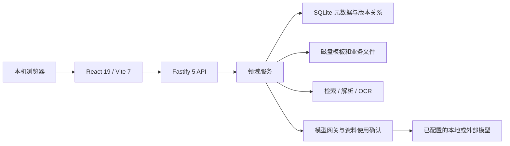

# 系统架构

文档ID：KB-ARCHITECTURE。版本：1.5。更新：2026-10-26。依据：当前源码及台式机reliability-20261024-r1发布核验。

本轮复核（2026-10-26）：源码已恢复为77887a6，应用架构无新增；.git已移出项目，当前以文件接续。当前设备仍运行ui-design-20261024-r1，下文reliability启动链和发布核验仅为云端原台式机记录。见[变更记录](docs/management/CHANGELOG.md)。

首批修复实现约束：助手沿用before_json保存执行后的目标字段值，撤销事务先比较当前值，冲突及缺少快照的历史动作拒绝撤销，force不能跳过；工时定稿按run ID共享进程内Promise，失败释放，依赖现有单服务锁，不宣称跨进程事务幂等。删除级联沿用deleted_at标识本批，独立删除操作生成不重复时间；恢复只恢复同批子项，普通文件读取与两类搜索共同校验父工作可见性。检查图片在期次之外继续按inspection_id过滤；备份仅清理本次唯一临时路径，旧残片保留；Word token恢复经过XML转义及换行/制表编码。工作记录复用NavigationGuard，保存仍在原表单完成，无新草稿存储机制。

## 1. 部署与组件



这是 npm workspaces 单仓库。后端 TypeScript 由 Node.js 24运行，开发也提供tsx；前端构建为静态资源，由同一服务提供。SQLite使用 `node:sqlite`，文档处理采用ExcelJS、PizZip、PDF.js、Tesseract.js。准确依赖以package-lock.json为准；本轮没有升级依赖或重新审计依赖漏洞。

## 2. 当前运行与开发代码分离

当前设备启动指针选择data/releases/ui-design-20261024-r1；下面reliability链路记录云端原台式机，不代表本次清理切换了运行包。

```text
启动工作台.cmd / npm start
  → scripts/start.mjs
  → data/runtime/current-release.json
  → data/releases/reliability-20261024-r1/packages/server/src/index.ts
  → 原 data/runtime/workbench.db + 原 data/files + 根 packages/web/dist
```

发布包不是脏工作区的镜像。本次以Git基点7902f92重建旧运行源码，并核对摘要与旧进程相同，再合入11份已验证修复。台式机原数据库已含038/039/040等40项迁移，本轮新增0项；工作记录入口保留并经日常页面核验。笔记本ui-design旧包排除038的事实保存在历史快照，不套用到台式机。启动器验证指针范围和发布清单，无效指针拒绝启动；直接运行源码绕过该选择。

健康接口的 `loadedBuild` 是进程加载时固定的后端、依赖锁、前端摘要；磁盘文件变化不意味着进程已经加载变化。本次核查见[运行基线](docs/reference/current-baseline.json)，后续发布必须重新核对。

## 3. 目录职责

### 换机开发与接续（2026-10-24复核）

台式机已完成源码接收、依赖准备、隔离验证及本轮本机发布；旧私有业务资料迁入与完整跨机往返未验收，不依赖Codex远程。仓库文档用于新设备接续，执行者本地保存、用户手动推送；正式运行由发布指针选择。worktree不能代替数据库、端口和外部文件隔离，main分支不等于正式发布。部署建议见换机清单第7节，收尾责任见[文档治理](docs/management/DOCUMENT_CONTROL.md)。

本次未改变应用架构。迁移需分别保存开发工作区（含未提交/未跟踪文件与Git历史）、正式运行组合（发布指针、所选包、配套根dist和依赖锁）、一致的数据与内部文件快照，以及外部绑定原件和本机工具。`.gitignore`排除data、outputs及dist，单纯Git拉取不包含完整运行现场。`scripts/pack.mjs`当前固定清单遗漏五份根接续文档、AGENTS、Git历史、发布指针与data/releases；即使附带运行数据，也不能单独作为开发换机包。详见[换机清单](docs/guides/DEVICE_HANDOFF.md)。

### 前台设计 V2（GOV-13，已限定发布）

笔记本历史ui-design-20261024-r1从monthly-workspaces基线合入界面及3个后端配套文件，排除工作记录，详见[报告45](docs/45-前台设计限定发布-2026-10-24.md)。台式机现由reliability-20261024-r1承接本机已运行的界面和工作记录能力，并修复RecordComposer离开保护；本轮没有重新设计界面，也没有把历史视觉/业务验收扩大为当前全部功能已验收。

`design.css` 和 `DesignSystem.tsx` 统一导航、卡片、列表与响应式布局。`NavigationGuard` 注册编辑区的 dirty/busy/save/discard，应用内导航统一保护；浏览器关闭保留原生警告。`useWorkbenchCollection` 分批读取全部工作后进行本地筛选和计数，防止单批截断造成数量错误。

全局密度由最后加载的 `compact.css` 控制：原生100%缩放下使用184px侧栏、13px正文和32px控件，桌面页面采用有界面板滚动，操作栏独立固定；工时页输入/结果滚动区与保存/导出栏分离，弹窗体内部滚动。

首页另由限定作用域的 `home.css` 对齐01设计图；`useWorkflowInbox` 将同一待办数据用于列表、摘要和待核对工作计数，避免独立请求形成不一致口径。首页使用单行页头和按图测量的约7:5列宽，窄屏转单列。

`AnnualLedgerWorkspace` 将记录列表、编辑缓冲、AI字段对照、实际文件预览和显式同步整合到现有期次。建议接口读取未保存快照但不写入；生成接口接收指定文件种类与修订，逐文件返回结果。同步先校验扫描令牌与冲突，再按映射字段决定是否写入，并返回各对象已更新/未改动/失败/未执行状态；这不是跨数据库和磁盘的整体事务或持久操作日志。

未新增数据库迁移或依赖。`scripts/preview-ui-design.mjs` 将前端构建、数据库、文件和备份隔离到 `.tmp/ui-design-preview`，默认18894，不修改日常指针或前端产物。详见[实现与核验边界](docs/guides/UI_DESIGN_IMPLEMENTATION.md)。

### 月度工作（040，已发布）

新增 `timesheet-workspace.ts` / `timesheet-layout.ts` 复用原工时计算、来源快照和ExcelJS；`MonthlyTimesheet` 替换原工时日常页面入口，名单偏好和逐月计算分开。多份考勤、扣薪例外、确认日历、局部修改及分配保存到计算输入，不把模型回复当成修改成功。旧XLS通过Windows Excel COM只读转换副本，禁用宏与外链。

`annual-ledger.ts` / `ledger-office.ts` 与 `/api/periods/:id/ledger` 管理年度台账、记录、关联文件和修订。040新增 `timesheet_preferences`、`annual_ledger`、`ledger_entry`、`ledger_entry_version`、`ledger_document`；隐藏UUID关联台账行和两表。文件摘要及共同基线参与三方比较，冲突解决带扫描令牌；写文件前再次比较摘要，替换前留版本。签字等历史文档不自动改写。

`AnnualLedger` 嵌入原月检期次，复用工作/期次与目录绑定；旧检查面板保留在折叠区。确认实际检查后桥接原 `inspection_record`；修改后待重新确认，旧事实不继续计入当前统计。`business-evidence.ts` 读取台账和关联文件状态，季度年度可引用，已导入历史和未确认草稿保留不确定性。网页编辑共享字段，完整Excel编辑由本机Office完成。

发布以039日常包为基础，只合入清单中的19项修改，助手范围推断等无关候选继续排除。040仅新增5张表；日常迁移前后64张原有表内容一致。旧包迁移器已在副本验证可保留040，回退功能不得删除新记录。

隔离启动 `scripts/dev-monthly.mjs` 将数据库、文件、前端均放入 `.tmp/monthly-development`，不更新日常发布指针。新模块来源和测试详见[开发指南](docs/guides/MONTHLY_DEVELOPMENT.md)。

| 目录/文件 | 职责 | 修改后的关联检查 |
|---|---|---|
| packages/web/src/pages | 工作台、期次、模板、助手、工时、设置等页面 | 实际浏览器任务、空态/失败/输入保护 |
| packages/web/src/components | 草稿、检查、成果、附件、预览等复用组件 | 入口间共享状态、晚到响应与旧版本 |
| packages/web/src/api.ts | API调用及前端类型 | 响应信封、错误、修订与会话令牌 |
| packages/server/src/index.ts | 启动、路由、文件访问与静态前端 | 锁、初始化顺序、错误信封 |
| packages/server/src/api | HTTP参数、状态码和领域调用 | 归属、字段、令牌、冲突和下载 |
| packages/server/src/domain | 工作、期次、检查、草稿、成果、工时、证据规则 | 业务约束及相关回归 |
| packages/server/src/core | 配置、文件、模板、检索、OCR、路径、锁、备份 | 数据完整性、隔离、异常补偿 |
| packages/server/src/ai | 模型网关、档案和外发确认 | 本地失败、请求范围、预算及降级 |
| packages/server/src/db | SQLite连接、迁移和SQL | 迁移集合、外键、历史兼容 |
| packages/server/test / scripts | 自动测试、隔离、启动与快照工具 | 操作是否初始化/写数据，不能凭名称视为只读 |
| docs / outputs / data | 知识文档 / 本机验证证据 / 运行数据与发布备份 | 后两者不保证随Git分发 |

所有源码、页面、路由声明、迁移及根npm命令可检索[静态源码索引](docs/reference/source-inventory.json)。

## 4. 领域和数据关系

业务术语唯一入口为[CONTEXT.md](CONTEXT.md)，数据库与接口详解见[DATA_AND_API.md](docs/reference/DATA_AND_API.md)。

- 工作类型定义适用流程和模板，工作实例与阶段/期次保留自己的快照；更新配置不能静默重写历史。
- 工作可有多个期次，项目可有多个阶段；期次不得复用同一套工作级阶段状态。
- 实际检查与草稿独立：草稿保存字段、来源、历史引用、修订与采用关联；实际统计继续依据inspection_record。
- 成果artifact关联工作、期次、检查/草稿修订及文件，doc_version保留版本关系；元数据与磁盘文件缺一不可。
- 工作记录038包含work_record、work_record_history、work_record_answer，仅属于开发候选。
- 迁移按文件名有序检查schema_migration中的完整版本标识；缺038仍可有039和040，不能按最大数字判断。

## 5. 关键链路与约束

### 5.1 月检共享草稿

页面InspectionDrafts与助手使用同一草稿服务；routes-workflow注册routes-inspection-drafts。读取当前期次与同工作历史 → 新建/恢复草稿 → 结构化建议或人工编辑 → 校验revision → 采用/生成。

suggest只接受允许字段，调用既有writing配置与网关；人工修改优先，陈旧响应不能覆盖新稿。request_key与采用/生成关联控制重复操作。核心事实齐全才调用saveInspection；模板额外必填单独判断。部分失败逐模板反馈，旧文件保留且可下载。

### 5.2 普通成果与证据写作

work-context/business-evidence收集有范围的资料；evidence-task/writing/checks处理事实、段落引用及局限；generate、document-write、document-source、versions、finalization完成文件与版本。

document-write串行化工作内写入并结合事务、提交回调和失败补偿；来源签名覆盖上下文、模板及文件，旧窗口令牌/修订错误返回冲突。规则整理和模型稿不同，自动引用检查仍不能证明一般语义正确性。

### 5.3 文件、模板与目录

模板目录使用category；适用范围沿用类型、通用标记与position_template_doc，不因目录展示复制模板。变量为 `{变量名}`；Word变量不能跨格式运行，Excel集合行必须符合既有模板引擎限制。

文件访问依据登记记录、root_kind和绑定根定位，不通过同名文件猜测。参考目录、业务目录及软删访问规则见store、paths、trash。外部原件不纳入默认内部文件快照。

### 5.4 工时、知识库与记忆

timesheets处理同月输入、匹配、计算、检查和导出，运行归属具体工作及期次。知识库保留原文与条款定位，本地解析与检索不等于资料适用性判断。扫描PDF直接OCR不作为现有完整能力。

旧agent_memory与038工作记录是不同机制；新记录不自动改写旧记忆或业务事实。工作记录查询、更正、撤回和引用修订不能绕开原业务确认。

## 6. 运行保护与已知限制

- 本机Host/Origin与会话令牌保护写API；这不是多用户身份权限系统。不要据此直接开放公网。
- 进程锁防止同一运行库重复服务；异常事件可记入健康记录，根因仍需实际诊断。
- 测试子进程启动前设置完整隔离环境，预加载检查早于数据库和目录初始化。
- Vite检查日常服务锁，禁止运行中默认覆盖根dist。错误提示提到的build:staged并非当前npm脚本，使用开发指南里的真实暂存构建命令。
- Office包有界读取、路径边界与来源检查是已有保护，不宣称整个系统已经通过安全认证。
- 自动备份主要保护数据库；完整恢复需数据库、文件、发布包、前端、配置与外部路径安排。

## 7. 维护与扩展

优先修改相关领域服务并补失败路径，避免复制readiness、模板适用性或来源规则。迁移、文件写入、删除和恢复变更必须在独立副本验证。发布只包含获准范围，配套比较依赖、后端、前端与迁移集合。

技术决策及剩余风险见[风险与决策](docs/management/RISKS_AND_DECISIONS.md)；历次架构演进见[整理前架构](docs/archive/2026-10-21-before-knowledge/SYSTEM_ARCHITECTURE.md)及报告22～43。
