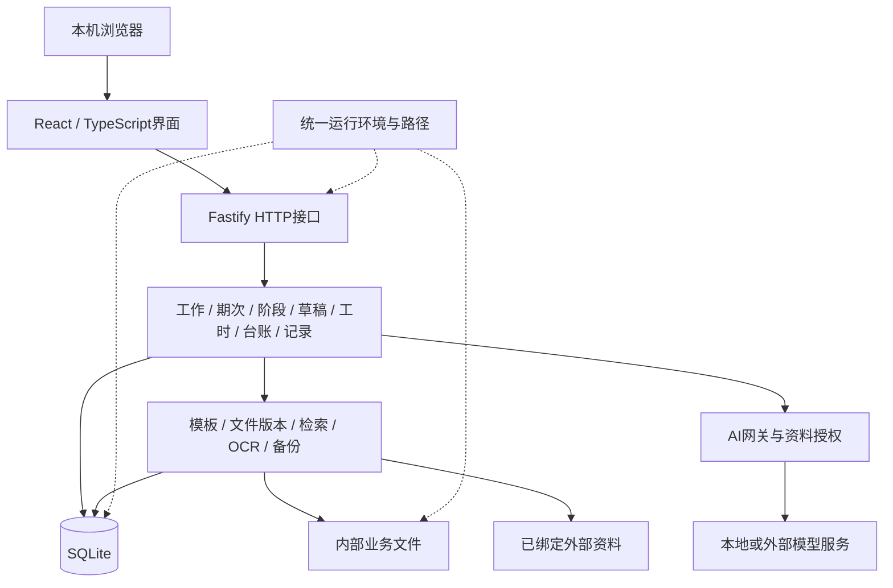

# 系统架构

文档ID：KB-ARCHITECTURE。版本：1.8。更新：2026-10-26。性质：当前源码的结构与运行设计。

本文回答系统由哪些部分组成、怎样协作和保存数据。实际运行版本、测试结果和交付进度由[开发进度](DEVELOPMENT_PROGRESS.md)维护；项目介绍见[README](README.md)，业务含义见[术语](CONTEXT.md)。复核：本次重整文档，应用结构未新增变更，见[变更记录](docs/management/CHANGELOG.md)。

## 1. 整体结构

工作台是面向本机单用户的模块化单体应用。React前端通过HTTP调用同一Fastify后端，后端在一个应用中组织业务模块、文件处理、数据库和AI能力。npm workspaces管理前后端依赖。

技术栈为React、Vite、TypeScript、Node.js 24+、Fastify及Node内置SQLite。文档处理使用ExcelJS、PizZip、PDF.js、Tesseract.js；旧版Excel转换依赖Windows上的Microsoft Excel。具体依赖版本以package-lock.json为准。

## 2. 模块与职责

| 位置 | 职责 |
|---|---|
| packages/web/src/pages | 首页、工作、流程规范、文件、知识、助手、设置、回收站及工作记录页面；工作内承载期次、阶段、工时和台账 |
| packages/web/src/components | 草稿、预览、附件、编辑保护及共享界面；NavigationGuard统一处理应用内离开确认 |
| packages/web/src/api.ts | HTTP调用、响应类型、错误与会话令牌处理 |
| packages/server/src/index.ts | 进程锁、初始化、请求保护、路由与静态资源注册 |
| packages/server/src/api | 参数与归属检查、错误响应、领域服务调用；常规响应使用ok/data或ok/error信封 |
| packages/server/src/domain | 工作、期次、阶段、检查草稿、成果、版本、工时、年度台账和工作记录等业务规则 |
| packages/server/src/core | 配置、路径、文件登记、模板、检索、OCR、日志、备份及运行保护 |
| packages/server/src/ai | 服务商与用途档案、模型调用网关、资料授权、调用日志和助手能力 |
| packages/server/src/db | SQLite连接、事务与有序迁移 |
| scripts | 允许共享的启动、开发、隔离测试运行器、打包、快照和仓库检查工具 |
| packages/server/test | 本机测试用例及夹具，不随源码上传、不作为应用构建依赖 |

这是职责划分，不宣称已经实现完全独立的模块部署或严格无环依赖。生产需要的旧Excel转换工具位于core/convert-legacy-excel.ps1，通过模块相对路径调用，不依赖本机测试脚本。

## 3. 业务对象与数据关系

工作类型定义流程、阶段要求和模板适用关系。具体工作承接这些规则，并关联各自的期次、阶段和成果。

- 周期工作通过work_period区分月、季、年范围；阶段通过position_instance表达项目过程，二者不混用。
- inspection_draft保存可编辑字段、来源及修订历史；inspection_record登记实际检查。草稿不自动进入真实检查统计。
- artifact登记成果与工作、期次、检查等的关联及文件位置；doc_version保留修订和核对关系。
- template及position_template_doc表达模板内容和适用范围；目录分类不等于复制业务事实或模板。
- 工时计算保存来源与计算输入；年度台账维护记录、修订、关联文件与同步依据。
- work_record及其历史、回答记录维护用户原话与有效引用；与旧agent_memory分开。

完整对象说明见[术语](CONTEXT.md)，字段与接口定位见[数据与API](docs/reference/DATA_AND_API.md)。实际数据库结构须核对schema_migration的完整集合，不能仅由源码文件或最高迁移编号推断。

## 4. 存储与文件一致性

SQLite保存业务记录、状态、关系、设置、模型配置和处理日志。磁盘保存实际模板、附件、原始副本、成果及历史版本。模型凭证属于当前环境的私有配置数据，不能进入共享文档或源码样例。

文件通过登记记录、根目录类型和已绑定路径定位，不按同名文件猜测。外部参考原件保持只读；可写的绑定成果按显式业务操作处理。外部原件不自动包含在内部文件快照中。

数据库与磁盘是两套存储：数据库事务不能单独保证文件操作成功。document-write、来源签名、修订校验、版本保留及失败补偿共同保护写入；不宣称存在覆盖所有数据库与文件操作的整体事务。

软删除、恢复和文件访问共同检查父对象状态。父级恢复只恢复同批删除对象，独立删除不混同；文件占用、异常补偿等完整验证范围见进度与GOV-01。

## 5. 关键业务链路

| 链路 | 处理方式与约束 |
|---|---|
| 检查草稿 | 当前期次及同工作历史 → 创建/恢复草稿 → 人工编辑或限定字段AI建议 → revision校验 → 采用/生成。人工修改优先，陈旧响应不能覆盖新稿；必要事实齐全且明确确认后才登记实际检查 |
| 文书生成 | 收集有范围的业务上下文与来源 → 模板及建议 → 生成、登记成果与版本 → 下载；来源变化提示重新核对，生成不代表报送或完成 |
| 月度工时 | 匹配确认名单、研发与考勤来源 → 校验/计算 → 保留输入版本 → 确认及Excel导出；同一run的并发定稿复用进程内Promise，失败后可重试，不宣称跨进程幂等 |
| 年度台账 | 记录编辑与修订 → 关联文档 → 摘要和共同基线三方比较 → 显式处理冲突 → 保存/生成/同步。修改后实际检查确认可能失效，不能继续计为当前事实 |
| 工作记录 | 原话、发生时间、性质与关联 → 持久保存 → 查询/更正/撤回 → 按有效修订引用；记录不自动成为外部证明 |
| 知识与OCR | 资料解析、原文/条款定位、检索及图片OCR；能找到资料不等于资料适用，扫描PDF直接OCR不作为已完成的通用能力 |

Word变量需符合当前模板引擎对格式运行的限制，Excel集合行需符合布局规则；结构解析不能代替Office分页、打印和重算检查。旧XLS转换使用上传副本，禁用宏与外链，不改写原件。

## 6. AI接入

业务服务按任务收集选定范围的上下文，通过ai/gateway选择用途档案及服务商，执行资料授权、模型请求、错误处理和调用记录。网关支持OpenAI兼容的聊天及向量接口，连接可配置的本地或外部服务。

历史、模型建议、规则整理与人工确认分别保留来源。助手写操作仍经过业务规则；覆盖写撤销需要比较执行后的目标值，不能覆盖后续人工修改，缺少快照也不能猜测撤销。制度参考默认关闭，本地模型失败不能自动转为未经授权的外发。

Git交付与模型请求是独立边界：数据不上传GitHub，不代表选择外部模型时不会发送本次授权范围内的资料。

## 7. 运行环境与配置

core/runtime-layout.ts只解析代码根、环境变量及本机配置，不打开数据库、不创建目录。启动器和应用配置使用此入口；备份执行与文件删除保护共用backupDirectoryConfig，OCR及升级工具同样使用当前环境路径。

| 模式 | 数据与配置 | 入口 |
|---|---|---|
| daily | 新安装默认源码外独立根；既有安装可识别legacy布局 | npm start / 启动工作台.cmd |
| development | 独立开发根，默认18889；清除继承的日常路径与常见凭证变量 | npm run dev / npm run server |
| test | 受控临时根；不读日常配置，不自动复制日常OCR或前端资源 | scripts/test-isolated.mjs |

新布局的环境根下分别保存workbench.config.json、files、runtime和backups。WORKBENCH_HOME选择日常根，WORKBENCH_DEV_HOME选择开发根；相对配置路径以环境根解释，显式资源变量优先。格式错误、路径越界、链接重定向及互相重叠的资源目录拒绝使用。详细规则见[资料边界](docs/guides/DATA_BOUNDARIES.md)。

Vite开发端口5273，代理跟随WORKBENCH_DEV_PORT，并在转发前核对后端development身份与预期数据库。只读代码或构建资源与可写业务资源分开；这不是操作系统权限沙箱。

## 8. 启动、发布与恢复

日常启动器读取当前环境的runtime/current-release.json，有有效指针时选择完整发布包，无指针时运行工作区源码；指针无效拒绝回退。旧布局使用项目data/runtime及data/releases，新布局按环境规则定位。

后端取得运行锁后，准备配置和目录，打开数据库并执行缺失迁移，补齐预置配置，加载绑定根及后台处理。健康接口的loadedBuild记录进程加载时身份；修改磁盘源码或推送Git不代表运行进程已升级。

自动数据库备份、成对文件快照和默认源码包用途不同。默认pack不读取真实配置，只打包允许共享的文件；显式私有完整备份不能上传。恢复需要核对数据库与文件、配置及外部路径配套，不能仅复制数据库冒充完整移交。

## 9. 交付、保护与扩展

仓库策略、忽略规则、提交/推送钩子及默认打包共同限制共享范围。应用编译入口只包含源码，本机测试使用独立配置；新克隆缺少测试用例不能被记录为测试通过。

本机Host/Origin与会话令牌保护写API，不构成多用户权限系统。功能扩展优先进入既有领域服务与迁移机制，避免重复规则；发布、真实数据迁移与付费模型调用分别依据有效授权。

安装见[安装指南](docs/guides/INSTALLATION.md)，开发见[开发指南](docs/guides/DEVELOPMENT.md)，操作与恢复见[运维手册](docs/guides/OPERATIONS.md)。历史架构和发布差异由[变更记录](docs/management/CHANGELOG.md)及本机历史报告承接，不在本文追加设备运行流水。
